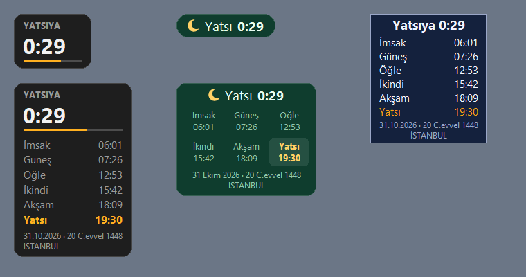

<p align="center"></p>

<h1 align="center">Ezan Vakti</h1>

<p align="center">
Windows için ekranın köşesinde her zaman üstte duran, küçük bir ezan vakti sayacı.<br>
Vakitler doğrudan <a href="https://namazvakitleri.diyanet.gov.tr">Diyanet İşleri Başkanlığı</a>'nın sitesinden alınır.
</p>

<p align="center">
<a href="../../releases/latest"><b>⬇ İndir (EzanVakti.exe)</b></a>
</p>

<p align="center"></p>

## Özellikler

- **Sıradaki vakte kalan süre**, örneğin `İkindiye 0:12`
- **Genişletilmiş mod:** kalan süre ile birlikte günün tüm vakitleri
- **Türkiye'deki tüm il ve ilçeler**
- **Sesli uyarı:**
  - Vakte kaç dakika kala çalacağı ve hangi vakitlerde çalacağı ayarlanır.
  - Ses seviyesi ayarlanır.
  - Basit sesler ve makam ezgileri (Hicaz, Uşşak, Rast) arasından seçilir; istenirse kendi `.wav` dosyan da kullanılır.
- **3 stil:** Kart, Hap ve Klasik
- **4 renk:** Koyu, Açık, Yeşil, Lacivert
- **Saydamlık seçenekleri,** "sadece yazı" modu dahil
- **Serbest boyut:** ayarlardan ya da pencere üzerinde `Ctrl` + fare tekerleği ile
- **Ekran kenarlarına yapışma:** yapışık kenarda kalır, birden fazla ekranda da çalışır
- **Türkçe ve İngilizce**
- **İnternet kesilse de çalışır:** yaklaşık bir yıllık vakit bilgisayara kaydedilir
- **Windows açılınca otomatik başlatma** (isteğe bağlı)
- **Hafif:** çalışırken işlemciyi neredeyse hiç kullanmaz

## Kurulum

1. [Son sürüm](../../releases/latest) sayfasından `EzanVakti.exe` dosyasını indir.
2. Çift tıkla. Kurulum gerekmez.
3. Açılan ayarlar penceresinden il ve ilçeni seç.

### Güvenlik uyarısı çıkarsa

Uygulama yeni ve dijital imzası olmadığı için Windows ve tarayıcılar uyarı gösterebilir. Bu, az indirilmiş imzasız programlarda olağan bir durumdur. Uygulamanın kaynak kodunun tamamı bu sayfada açık.

- **İndirirken** (Edge / Chrome: *"EzanVakti.exe isn't commonly downloaded"*): indirilen dosyanın yanındaki **⋯** menüsünden **Sakla (Keep)** seç. Bir uyarı daha çıkarsa **Daha fazla göster → Yine de sakla** de.
- **Açarken** (*"Windows kişisel bilgisayarınızı korudu"*): **Ek bilgi → Yine de çalıştır**.

## Kullanım

| İşlem | Nasıl |
|---|---|
| Taşımak | Pencereyi sürükle (ekran kenarlarına yapışır) |
| Tüm vakitlere göz atmak | Küçük moddayken pencereyi yerinde basılı tut |
| Boyutu değiştirmek | Pencere üzerinde `Ctrl` + fare tekerleği |
| Ayarlar ve çıkış | Sağ tık |

Ayarlar `%APPDATA%\EzanVakti` klasöründe saklanır.

## Kaynak koddan çalıştırma

Python 3 yeterli; ek paket gerekmez.

```bash
python ezan_vakti.py
```

`.exe` oluşturmak için:

```bash
pip install pyinstaller
pyinstaller --onefile --windowed --name EzanVakti --icon ikon.ico --add-data "ikon.ico;." --version-file surum_bilgisi.txt ezan_vakti.py
```

## Not

Bu uygulama gönüllü olarak geliştirilmiş, resmi olmayan bir projedir ve Diyanet İşleri Başkanlığı ile bir bağlantısı yoktur. Vakit bilgileri Diyanet'in herkese açık sitesinden okunur.

---

## English

A tiny always-on-top prayer times widget for Windows. It shows the time left until the next prayer, using official times from the Turkish Presidency of Religious Affairs (Diyanet). It covers every province and district in Turkey and includes:

- Sound alerts
- Three styles and four color themes
- Adjustable transparency and size
- Snapping to screen edges
- Turkish and English interface

[Download the latest release](../../releases/latest), run `EzanVakti.exe`, and pick your location.
